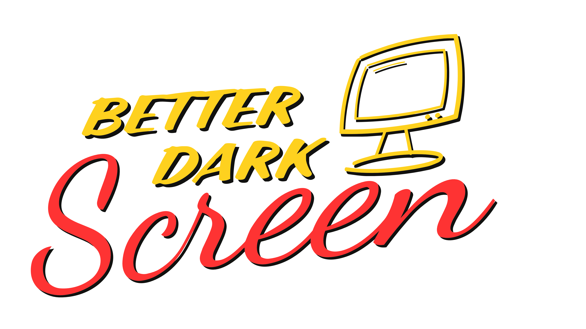

<div align="center">



# BetterDarkScreen

**Dim every monitor from the tray. No more reaching for the buttons.**

[](https://github.com/dehobitto/BetterDarkScreen/stargazers)
[](https://github.com/dehobitto/BetterDarkScreen/releases)
[](https://github.com/dehobitto/BetterDarkScreen/releases/latest)
[](https://github.com/dehobitto/BetterDarkScreen/actions)


</div>

---

> Did you know that your eyes have rights? Your doctor says they do. And so do I. I believe that until proven guilty, every man, woman, dev and child on this planet is innocent, even the lazy ones. And that’s why I dim for you, devs!

---

## Why

Changing monitor brightness means reaching for awkward buttons, so most of us just don't, and the screen hits your eyes at night.
BetterDarkScreen puts a slider for each monitor in the tray and can turn dimming on and off by itself.

Existing tools didn't work with some popular monitors and were hard to tune, so this one lets you pick how each screen is dimmed.

## Features

- **Per monitor**: its own level (0–95 %), on/off and method, or link all sliders
- **Four methods**, per monitor or for all:

  | Method | How | Good for |
  |---|---|---|
  | **Hardware** | Monitor's own brightness (DDC/CI, laptops: Windows API) | Best picture |
  | **Overlay** | Dark click-through layer | Desktop, video, windowed games, below 0 % |
  | **Gamma** | Graphics card gamma | Exclusive-fullscreen games |
  | **Auto** *(default)* | Overlay, Gamma when a game is fullscreen | Set and forget |

- **Schedule**: always, custom hours or sunset to sunrise (offline), with smooth fades
- **Pause** for 15 min / 1 h / 3 h / until resumed
- **Hotkeys**, configurable
- **Game safe**: no injection, no hooks. Screenshots and streams stay bright (Overlay)
- **Light**: ~0 % CPU when idle, no network, settings in one JSON file

## Install

Download from [Releases](../../releases) and run it. Single file, no .NET install needed:

- `BetterDarkScreen-<version>-win-x64.exe`: regular, fastest start
- `BetterDarkScreen-<version>-win-x64-small.exe`: ~3x smaller file, uses a bit more RAM

The monitor icon appears in the tray. Turn on **Settings → General → Start with Windows** to run it at login.

## Usage

- **Left-click** the tray icon: quick panel with sliders, method and pause
- **Right-click**: menu with settings and exit
- Default hotkeys: `Ctrl+Alt+PgDn` dim more, `Ctrl+Alt+PgUp` dim less, `Ctrl+Alt+End` on/off. Change them in **Settings → Hotkeys**.

## Troubleshooting

<details>
<summary><b>Hardware is missing or doesn't change anything</b></summary>

Turn on **DDC/CI** in the monitor's on-screen menu and reconnect the cable. Some docks, KVMs and adapters block DDC/CI.
If brightness only goes down, the monitor's picture mode may lock it (for example Samsung: Eye Saver, Eco or some picture modes). Switch to a **Custom** / standard mode.
</details>

<details>
<summary><b>Screen blinks or restarts on Hardware</b></summary>

Some monitors can't handle frequent brightness commands. Turn on **Settings → Displays → Slow mode** for that monitor: brightness then changes in one step, after you stop moving the slider.
</details>

<details>
<summary><b>Gamma stops at about 50 %</b></summary>

Windows limits gamma. Use **Settings → Dimming → Deeper gamma dimming → Unlock** (admin), then sign out. Gamma doesn't work in HDR.
</details>

<details>
<summary><b>The overlay doesn't show in a game</b></summary>

The game is in exclusive fullscreen. Use **Auto** or **Gamma**, or switch the game to borderless.
</details>

<details>
<summary><b>The app crashed. Is my screen stuck dark?</b></summary>

No. Gamma resets on any crash, and hardware brightness is restored on the next start.
</details>

## Build from source

Needs the [.NET 8 SDK](https://dotnet.microsoft.com/download/dotnet/8.0).

```powershell
.\build.ps1          # -> publish\BetterDarkScreen-<version>-win-x64.exe
.\build.ps1 -Small   # -> publish\BetterDarkScreen-<version>-win-x64-small.exe
dotnet run --project src
```

## Contributing

Issues and PRs are welcome, see [CONTRIBUTING.md](CONTRIBUTING.md). Monitor model, GPU and whether DDC/CI worked help a lot in bug reports.

## License

[MIT](LICENSE) © 2026 Alex Makarov
